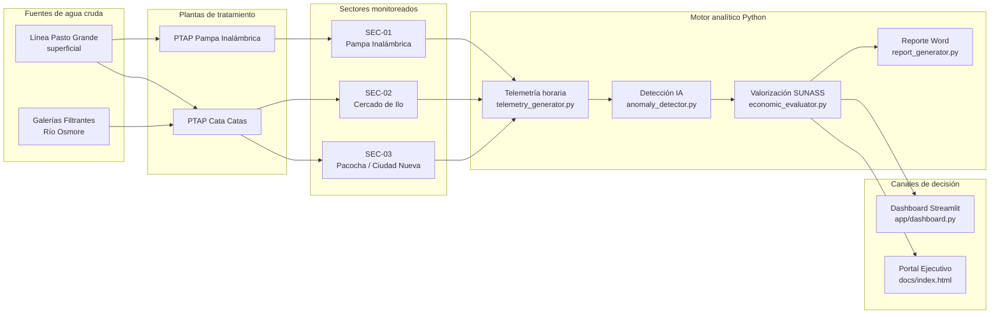
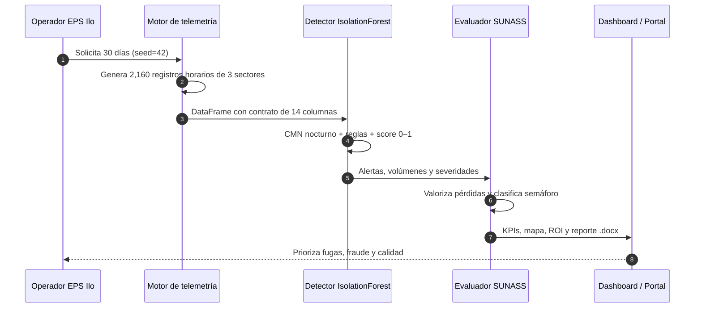
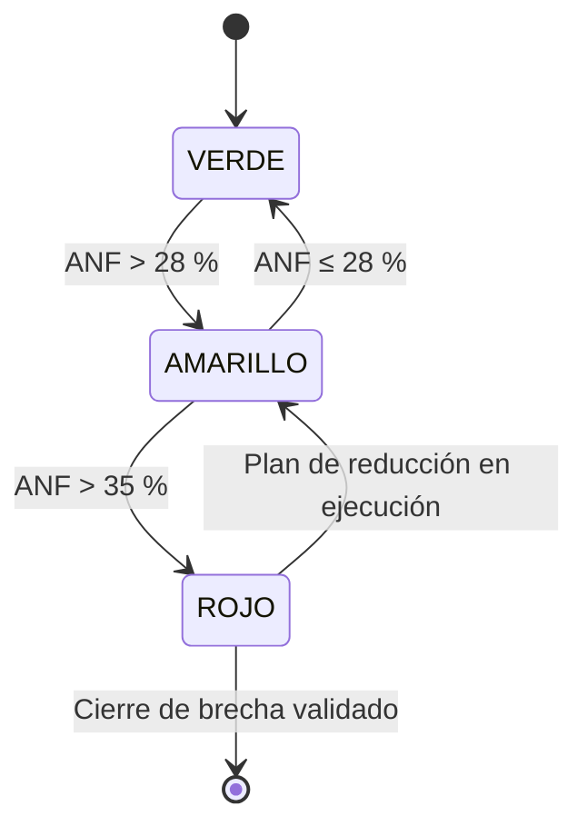
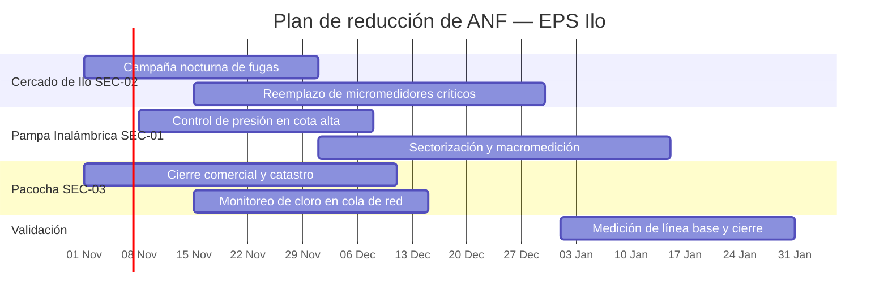

# SIOC EPS Ilo — Inteligencia operativa para reducir el Agua No Facturada

> **Sistema Integrado de Operaciones, Control de ANF e Inteligencia Comercial** para EPS Ilo S.A. (Ilo, Moquegua — Perú).
> Convierte telemetría hidráulica en decisiones priorizadas, valorizadas en soles y listas para ejecutar.

[](https://www.python.org/)
[](tests/)
[](https://sioc-eps-ilo.streamlit.app/)
[](https://rene-pongo.github.io/sioc-eps-ilo/)
[](https://www.sunass.gob.pe/)

---

## 1. Resumen ejecutivo

EPS Ilo enfrenta una brecha crítica entre el agua producida y el agua facturada. La corrida de validación del sistema, sobre **30 días de telemetría horaria** de los tres sectores operativos, arroja:

| Indicador | Resultado | Lectura ejecutiva |
|---|---:|---|
| **ANF global** | **30.68 %** | Por encima de la meta referencial (28 %) → **alerta amarilla SUNASS** |
| Agua producida | **337,512.888 m³** | Volumen entregado a red en 30 días |
| Agua facturada | **233,980.657 m³** | Volumen con ingreso asociado |
| **ANF total** | **103,532.231 m³** | Equivale a **~3,451 m³/día** no facturados |
| Pérdida física | **101,251.084 m³** | Fugas, roturas y submedición de red |
| Pérdida comercial | **2,281.147 m³** | Subregistro asociado a fraude comercial |
| **Pérdida económica valorizada** | **S/ 398,599.09** | A tarifa media ponderada de S/ 3.85/m³ |
| Costo energía y químicos perdido | **S/ 124,238.68** | Costo variable de producción de S/ 1.20/m³ |
| Alertas inteligentes generadas | **144** | 13 fugas, 22 fraudes, 26 cloro, 8 turbiedad, 3 presión, 72 patrones atípicos |

**Hallazgo principal:** **SEC-02 Cercado de Ilo** es el sector más crítico, con **34.91 % de ANF** y **6 alertas de fuga física**. Está a **0.09 puntos porcentuales** del umbral rojo (> 35 %). Le siguen SEC-01 Pampa Inalámbrica (30.91 %) y SEC-03 Pacocha / Ciudad Nueva (26.78 %).

**Decisión recomendada:** intervenir primero el Cercado de Ilo con un plan nocturno de detección de fugas y macromedición; simultáneamente, cerrar el círculo comercial en Pacocha, donde se concentran **10 fraudes** y **26 alertas de cloro**.

> **Nota de gobierno de datos:** las cifras provienen de un dataset sintético reproducible (`seed=42`) que modela la operación real de Ilo. No sustituyen mediciones de campo ni el cierre comercial auditado; son la línea base para priorizar pilotos y validar el modelo con datos de producción.

---

## 2. Demos web

| Demo | Enlace | Uso recomendado |
|---|---|---|
| **Portal Ejecutivo** — Glassmorphism + mapa de Ilo + simulador ANF | **[rene-pongo.github.io/sioc-eps-ilo](https://rene-pongo.github.io/sioc-eps-ilo/)** | Presentación a gerencia y directorio, sin instalar nada |
| **Dashboard Streamlit** — análisis interactivo + descarga Word | **[sioc-eps-ilo.streamlit.app](https://sioc-eps-ilo.streamlit.app/)** | Analistas, jefes de operaciones y planificación |
| **Repositorio** | [github.com/Rene-Pongo/sioc-eps-ilo](https://github.com/Rene-Pongo/sioc-eps-ilo) | Código, trazabilidad y despliegue |
| **Especificación técnica** | [PLAN_ARQUITECTURA.md](https://github.com/Rene-Pongo/sioc-eps-ilo/blob/main/PLAN_ARQUITECTURA.md) | Contratos de datos y reglas de negocio |
| **Referencia normativa** | [SUNASS](https://www.sunass.gob.pe/) | Metas y fiscalización |

**Ejecución local en 3 comandos:**

```bash
python3 -m venv .venv && source .venv/bin/activate
pip install -r requirements.txt
streamlit run app/dashboard.py          # http://localhost:8501
```

---

## 3. Arquitectura del monorepo



La arquitectura es **modular y auditable**: cada módulo tiene un contrato de entrada/salida fijo, lo que permite reemplazar el generador sintético por lecturas SCADA o macromedidores sin reescribir la analítica.

---

## 4. Flujo de inteligencia operativa



**Reglas que disparan una alerta:**

- **Fuga física:** caudal nocturno (00:00–04:59) por encima del CMN base del sector, con exceso ≥ `max(30 % del CMN, 5 l/s)`.
- **Fraude comercial:** ANF diurno por encima de la mediana sectorial + `max(8 pp, 2.5 × RIC)`.
- **Calidad:** cloro residual libre < **0.5 mg/L** o turbiedad > **5.0 NTU**.
- **Presión:** fuera del rango normativo de **10–50 m.c.a.**
- **Patrón atípico:** score de `IsolationForest` ≥ 0.95.

---

## 5. Semáforo normativo SUNASS



| Estado | Rango ANF | Acción de gestión |
|---|---|---|
| 🟢 **VERDE** | ≤ 28 % | Sostener control y monitorear tendencia |
| 🟡 **AMARILLO** | > 28 % y ≤ 35 % | Plan táctico de fugas y micromedición |
| 🔴 **ROJO** | > 35 % | Intervención prioritaria y comité de crisis |

**Situación actual:** 🟡 **AMARILLO global (30.68 %)**. SEC-02 está al borde del rojo y debe tratarse como prioridad absoluta.

---

## 6. Sectores y activos modelados

| Sector | Población | Conexiones | Demanda base | Continuidad | ANF base | Activo crítico |
|---|---:|---:|---:|---|---:|---|
| **SEC-01** Pampa Inalámbrica | 28,500 | 7,100 | 58 l/s | 18–22 h/día | 30.5 % | Cota alta, presiones bajas, expansión urbana |
| **SEC-02** Cercado de Ilo | 24,200 | 6,400 | 46 l/s | 20–24 h/día | 34.0 % | Red antigua, fugas invisibles, micromedidores viejos |
| **SEC-03** Pacocha / Ciudad Nueva | 21,800 | 5,200 | 52 l/s | 21–24 h/día | 26.5 % | Consumo mixto, cloro en cola de red, alto valor comercial |

**Infraestructura:**

- **Fuentes:** Línea de Conducción Pasto Grande (180 l/s de diseño) y Galerías Filtrantes del Río Osmore (120 l/s).
- **PTAP Cata Catas:** 170 l/s; abastece Cercado y Pacocha.
- **PTAP Pampa Inalámbrica:** 95 l/s; abastece Pampa Inalámbrica.

---

## 7. Módulos y contratos de datos

| Módulo | Función pública | Salida |
|---|---|---|
| `src/config.py` | Parámetros normativos y operativos | `SECTORS`, `SOURCES`, `PTAPS`, `NORMATIVE_LIMITS`, `TARIFF_STRUCTURE`, `BACKGROUND_IMAGES` |
| `src/telemetry_generator.py` | `generate_telemetry_data(days=30, seed=42, inject_anomalies=True)` | DataFrame de 14 columnas, 24 registros/día/sector |
| `src/anomaly_detector.py` | `detect_anomalies(df, contamination=0.05)` | DataFrame + 10 columnas de alerta, score, tipo y severidad |
| `src/economic_evaluator.py` | `evaluate_economic_impact(df)` / `simulate_anf_reduction_roi(...)` | Métricas globales, desagregado sectorial y ROI |
| `src/report_generator.py` | `generate_executive_docx_report(...)` | Reporte Word en memoria, descargable |
| `src/ui_glassmorphism.py` | CSS, fondos aleatorios, tarjetas KPI y tema Plotly | Motor visual “Luminance-Safe Glassmorphism” |
| `app/dashboard.py` | Dashboard Streamlit de 5 pestañas | Operación, IA, economía, mapa, ROI y Word |
| `docs/` | Portal ejecutivo estático | GitHub Pages con mapa Leaflet y Chart.js |

**Contrato de telemetría:** `timestamp`, `sector_id`, `sector_name`, `fuente_principal`, `caudal_lps`, `presion_mca`, `cloro_mg_l`, `turbiedad_ntu`, `continuidad_horas`, `volumen_producido_m3`, `volumen_facturado_m3`, `anf_m3`, `anf_pct`, `injected_event`.

---

## 8. Resultados de la corrida de validación

### 8.1 Desempeño por sector

| Sector | Registros | Alertas | % alertas | Fugas | Fraudes | Cloro | Turbiedad | Presión | ANF prom. | Severidad máx. |
|---|---:|---:|---:|---:|---:|---:|---:|---:|---:|---|
| SEC-01 Pampa Inalámbrica | 720 | 54 | 7.50 % | 4 | 6 | 0 | 8 | 3 | 26.06 % | Crítica |
| SEC-02 Cercado de Ilo | 720 | 35 | 4.86 % | 6 | 6 | 0 | 0 | 0 | 32.31 % | Crítica |
| SEC-03 Pacocha / Ciudad Nueva | 720 | 55 | 7.64 % | 3 | 10 | 26 | 0 | 0 | 25.44 % | Crítica |

### 8.2 Valorización económica

| Sector | Producido (m³) | Facturado (m³) | ANF (m³) | ANF % | Pérdida física (m³) | Pérdida comercial (m³) | Valorizado (S/) | Semáforo |
|---|---:|---:|---:|---:|---:|---:|---:|---|
| SEC-01 | 119,554.272 | 82,596.093 | 36,958.179 | 30.91 % | 36,315.226 | 642.953 | 142,288.99 | 🟡 AMARILLO |
| SEC-02 | 101,006.100 | 65,746.522 | 35,259.578 | 34.91 % | 34,642.262 | 617.316 | 135,749.38 | 🟡 AMARILLO |
| SEC-03 | 116,952.516 | 85,638.042 | 31,314.474 | 26.78 % | 30,293.596 | 1,020.878 | 120,560.73 | 🟢 VERDE |
| **Total** | **337,512.888** | **233,980.657** | **103,532.231** | **30.68 %** | **101,251.084** | **2,281.147** | **398,599.09** | 🟡 **AMARILLO** |

---

## 9. Simulador What-If / ROI

Sobre un ANF mensual de referencia de **103,532.231 m³** y una inversión inicial de **S/ 45,000**:

| Reducción objetivo | m³ recuperados/mes | Ahorro mensual | Ahorro anual | Payback | VAN 12 meses | ROI |
|---:|---:|---:|---:|---:|---:|---:|
| 10 % | 10,353.223 | S/ 39,859.91 | S/ 478,318.91 | 1.13 meses | S/ 405,078.80 | 962.93 % |
| **20 %** | **20,706.446** | **S/ 79,719.82** | **S/ 956,637.81** | **0.56 meses** | **S/ 855,157.60** | **2,025.86 %** |
| 30 % | 31,059.669 | S/ 119,579.73 | S/ 1,434,956.72 | 0.38 meses | S/ 1,305,236.40 | 3,088.79 % |

> El ROI se calcula con tarifa media de S/ 3.85/m³ y tasa de descuento anual de 12 %. Un plan de **20 % de reducción** se paga en **menos de un mes** bajo el modelo. La inversión real debe ajustarse con cotizaciones de campo y validación de caudales.

---

## 10. Suite de pruebas — 100 % passing

```text
$ .venv/bin/python -m pytest tests -q
........................................................................ [ 69%]
................................                                         [100%]
104 passed in 5.29s
```

| Archivo | Pruebas | Qué garantiza |
|---|---:|---|
| `tests/test_telemetry.py` | **31** | Contrato de 14 columnas, 2,160 registros, identidades volumétricas, rangos físicos, continuidad, reproducibilidad y validación de parámetros |
| `tests/test_anomaly_detector.py` | **36** | Ventana nocturna y CMN, detección de los 5 eventos, banderas booleanas, score 0–1, tipos/severidades y resumen sectorial |
| `tests/test_economic_evaluator.py` | **37** | Totales globales/sectoriales, separación física vs. comercial, semáforo SUNASS, valorización tarifaria, ROI, payback, VAN y validaciones |

**Cobertura funcional clave:**

- **Contrato de datos:** cualquier regresión en nombres, orden o tipos de columnas rompe la suite.
- **Coherencia física:** caudal × 3.6 = volumen; ANF = producido × %; facturado = producido − ANF.
- **Reglas de negocio:** una fuga nocturna, un fraude diurno, cloro bajo, turbiedad alta y presión fuera de rango deben generar su alerta.
- **Economía:** pérdida física + comercial = ANF total; valorización a tarifa oficial; semáforo en los umbrales 28 % y 35 %.
- **ROI:** payback × ahorro recupera la inversión; VAN y ROI siguen la fórmula financiera declarada.

---

## 11. Instalación y uso

```bash
# 1. Clonar
git clone https://github.com/Rene-Pongo/sioc-eps-ilo.git
cd sioc-eps-ilo

# 2. Entorno
python3 -m venv .venv
source .venv/bin/activate
pip install -r requirements.txt

# 3. Pruebas
python -m pytest tests -q

# 4. Dashboard
streamlit run app/dashboard.py

# 5. Portal estático
python -m http.server 8000 --directory docs
# abrir http://localhost:8000
```

**Requisitos:** Python 3.11+, pandas, numpy, scikit-learn, plotly, streamlit, python-docx y pytest.

---

## 12. Estructura del repositorio

```text
sioc-eps-ilo/
├── README.md
├── PLAN_ARQUITECTURA.md
├── requirements.txt
├── src/
│   ├── config.py
│   ├── telemetry_generator.py
│   ├── anomaly_detector.py
│   ├── economic_evaluator.py
│   ├── report_generator.py
│   └── ui_glassmorphism.py
├── app/
│   └── dashboard.py
├── docs/
│   ├── index.html
│   ├── styles.css
│   └── app.js
└── tests/
    ├── conftest.py
    ├── test_telemetry.py
    ├── test_anomaly_detector.py
    └── test_economic_evaluator.py
```

---

## 13. Hoja de ruta recomendada — 90 días



| Prioridad | Acción | Sector | Impacto esperado |
|---|---|---|---|
| 1 | Detección nocturna de fugas + macromedición | SEC-02 | Evitar cruce a rojo (> 35 %) y recuperar ~35,260 m³/mes |
| 2 | Control de presión y sectorización | SEC-01 | Reducir roturas y fugas en cota alta |
| 3 | Cierre comercial, catastro y micromedición | SEC-03 | Atacar 10 fraudes y mejorar facturación de alto valor |
| 4 | Monitoreo continuo de cloro residual | SEC-03 | Cumplimiento DIGESA en cola de red |
| 5 | Reemplazo de micromedidores antiguos | SEC-02 | Reducir subregistro comercial |

---

## 14. Gobierno, límites y siguientes pasos

- **Datos sintéticos:** el motor reproduce patrones operativos reales, pero las decisiones de inversión deben validarse con SCADA, macromedidores y catastro comercial.
- **Trazabilidad:** cada corrida es reproducible por `seed`; los contratos de datos están cubiertos por pruebas automatizadas.
- **Seguridad:** no se almacenan credenciales ni datos personales; los secretos van en `.streamlit/secrets.toml` (excluido por `.gitignore`).
- **Escalabilidad:** el pipeline puede conectarse a una base de datos horaria o API SCADA manteniendo el mismo contrato de 14 columnas.

**Siguiente hito sugerido:** piloto de 30 días en SEC-02 con medición de caudal nocturno antes/después y validación del ROI real.

---

## 15. Autoría

**Rene-Pongo** — diseño, desarrollo y validación del monorepo.
Proyecto: SIOC EPS Ilo S.A. — Ilo, Moquegua, Perú.
Licencia y uso: revisar lineamientos institucionales de EPS Ilo S.A. y SUNASS.
